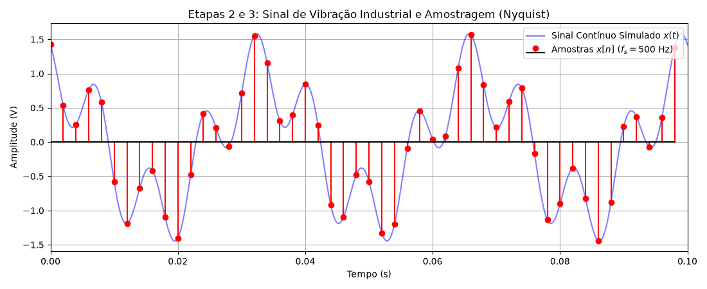
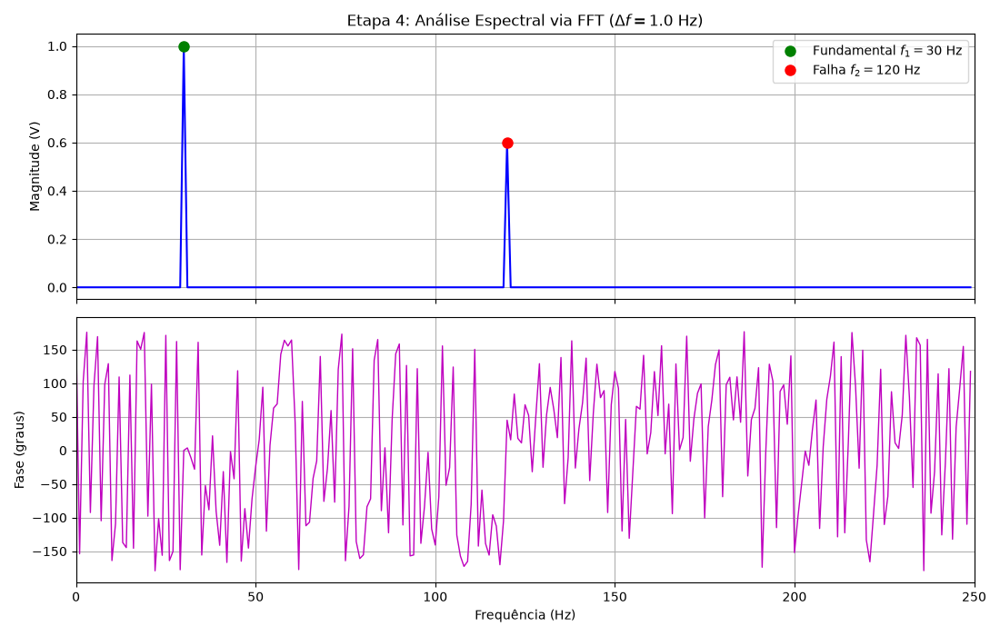
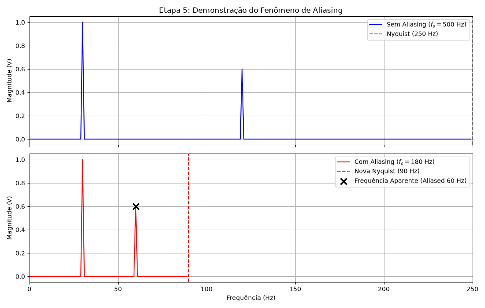
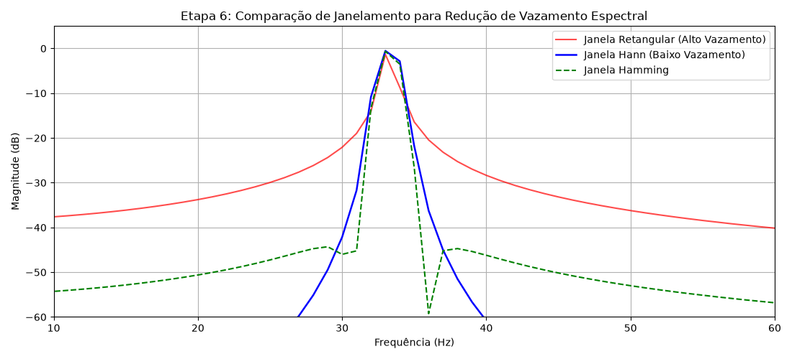
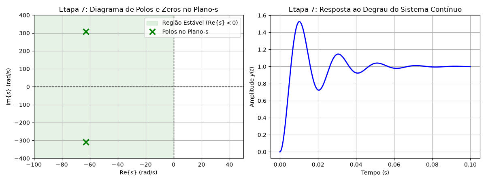
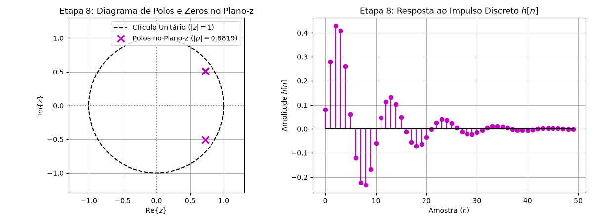
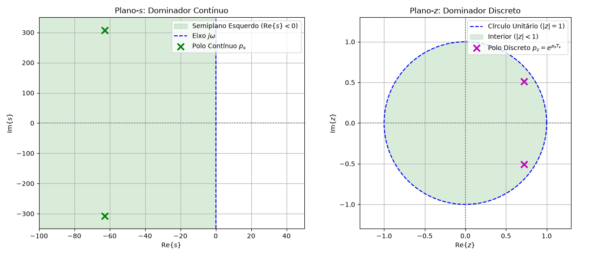

# Relatório Técnico — Mini Projeto Integrador (Parte 2): Análise Multidomínio de Sinais e Sistemas

---

## 1. Apresentação e Escolha da Aplicação (Etapa 1)

### 1.1 Contextualização da Aplicação de Engenharia
No contexto da Engenharia de Manutenção Preditiva e Mecatrônica Industrial, o **Monitoramento contínuo da Vibração Mecânica de Motores Elétricos** e mancais de rolamento é fundamental para prevenir falhas catastróficas em linhas de produção automatizadas.

Um motor de indução trifásico em operação normal gera uma vibração senoidal fundamental associada à frequência de rotação do seu eixo primário ($1800\text{ RPM} \implies f_1 = 30\text{ Hz}$). Quando surge um defeito localizado no rolamento (como uma microfissura ou desgaste na pista externa do mancal), cada passagem de elemento rolante sobre a imperfeição gera um impacto periódico em alta frequência ($f_2 = 120\text{ Hz}$).

O objetivo deste projeto integrador é aplicar a **Análise Multidomínio** (Tempo $\rightarrow$ Frequência $\rightarrow$ Plano-$s$ $\rightarrow$ Plano-$z$) sobre o sinal de vibração capturado por um acelerômetro piezoelétrico acoplado ao mancal, modelando também a dinâmica mecânica do suporte do motor como um sistema de segunda ordem.

---

## 2. Geração do Sinal e Critério de Amostragem (Etapas 2 e 3)

### 2.1 Modelo Matemático do Sinal Analógico $x(t)$
O sinal elétrico gerado pelo acelerômetro $x(t)$ (em Volts) é modelado pela soma de duas componentes senoidais puras com fases distintas:
$$x(t) = A_1 \cos(2\pi f_1 t + \phi_1) + A_2 \cos(2\pi f_2 t + \phi_2)$$

Definem-se os seguintes parâmetros físicos:
- **Componente Fundamental do Eixo ($f_1$)**: $f_1 = 30.0\text{ Hz}$, Amplitude $A_1 = 1.0\text{ V}$, Fase $\phi_1 = 0.0\text{ rad}$.
- **Componente de Impacto do Rolamento ($f_2$)**: $f_2 = 120.0\text{ Hz}$, Amplitude $A_2 = 0.6\text{ V}$, Fase $\phi_2 = \frac{\pi}{4}\text{ rad}$.
- **Janela de Observação Temporal ($T_{\text{obs}}$)**: $T_{\text{obs}} = 1.0\text{ s}$.

### 2.2 Critério de Nyquist e Escolha da Frequência de Amostragem ($f_s$)
Pelo **Teorema da Amostragem de Nyquist-Shannon**, para que um sinal contínuo limitado em faixa com frequência máxima $f_{\max}$ possa ser reconstruído perfeitamente sem perda de informação, a frequência de amostragem $f_s$ deve satisfazer a desigualdade estrita:
$$f_s > 2 f_{\max}$$

Como a maior frequência do sinal analógico é $f_{\max} = f_2 = 120.0\text{ Hz}$, a frequência mínima de Nyquist é:
$$f_{\text{Nyquist}} = 2 \times 120.0\text{ Hz} = 240.0\text{ Hz}$$

Para garantir uma amostragem adequada com margem de segurança contra transitórios, adota-se a frequência de amostragem **$f_s = 500.0\text{ Hz}$** ($T_s = \frac{1}{f_s} = 2.0\text{ ms}$). O número total de amostras discretas em $1.0\text{ s}$ é $N = f_s \times T_{\text{obs}} = 500\text{ amostras}$.

O sinal discreto obtido pela amostragem uniforme $t = n T_s$ é dado por:
$$x[n] = x(n T_s) = 1.0 \cos\left(2\pi \frac{30}{500} n\right) + 0.6 \cos\left(2\pi \frac{120}{500} n + \frac{\pi}{4}\right)$$

---

## 3. Análise Espectral via FFT (Etapa 4)

### 3.1 Cálculo da FFT e Resolução Espectral ($\Delta f$)
A Transformada Discreta de Fourier (DFT) do sinal discreto $x[n]$ é calculada de forma computacionalmente eficiente utilizando o algoritmo da **Fast Fourier Transform (FFT)** de $N = 500$ pontos:
$$X[k] = \sum_{n=0}^{N-1} x[n] e^{-j \frac{2\pi}{N} k n}, \quad k = 0, 1, \dots, N-1$$

A **Resolução Espectral ($\Delta f$)**, que representa o espaçamento entre dois *bins* consecutivos de frequência na FFT, é calculada por:
$$\Delta f = \frac{f_s}{N} = \frac{500.0\text{ Hz}}{500\text{ amostras}} = 1.0\text{ Hz/bin}$$

### 3.2 Identificação das Componentes Espectrais
Como os picos ocorrem exatamente em múltiplos inteiros de $\Delta f = 1.0\text{ Hz}$:
- **Bin $k_1 = 30$**: Corresponde a $f = 30 \times 1.0\text{ Hz} = 30.0\text{ Hz}$, revelando o pico de magnitude de $1.0\text{ V}$.
- **Bin $k_2 = 120$**: Corresponde a $f = 120 \times 1.0\text{ Hz} = 120.0\text{ Hz}$, revelando o pico de magnitude de $0.6\text{ V}$.

A análise espectral via FFT confirma com precisão de $1.0\text{ Hz}$ a presença das duas frequências originais, permitindo isolar a componente de vibração do rolamento da vibração padrão do motor.

---

## 4. Investigação do Fenômeno de Aliasing (Etapa 5)

### 4.1 Subamostragem e Violação de Nyquist
Para investigar experimentalmente as consequências do desrespeito ao Teorema de Nyquist, reduz-se intencionalmente a frequência de amostragem para **$f_s = 180.0\text{ Hz}$** ($T_s \approx 5.55\text{ ms}$).

Com $f_s = 180.0\text{ Hz}$, a nova frequência limite de Nyquist cai para:
$$f_{N} = \frac{f_s}{2} = \frac{180.0}{2} = 90.0\text{ Hz}$$

Como a componente de falha do rolamento ($f_2 = 120.0\text{ Hz}$) supera o limite de Nyquist ($120.0\text{ Hz} > 90.0\text{ Hz}$), ela sofre o fenômeno de **aliasing (recobrimento espectral)**.

### 4.2 Formulação Matemática da Frequência Aparente ($f_{\text{alias}}$)
A frequência discreta normalizada dobrada em torno da frequência de amostragem gera um espectro espelhado na banda primária $[0, f_N]$. A frequência aparente observada na FFT é dada por:
$$f_{\text{alias}} = |f_2 - f_s| = |120.0 - 180.0| = 60.0\text{ Hz}$$

### 4.3 Implicações Práticas na Engenharia
Na FFT do sinal subamostrado ($f_s = 180\text{ Hz}$), a componente real de $120\text{ Hz}$ desaparece e surge falsamente um pico proeminente em **$60.0\text{ Hz}$**. Em um sistema automatizado de diagnóstico de máquinas, esse erro levaria o algoritmo a diagnosticar incorretamente uma falha elétrica de 2ª harmônica da rede ($60\text{ Hz}$) em vez da falha real no rolamento ($120\text{ Hz}$), podendo causar paradas não programadas e avarias no equipamento.

---

## 5. Janelamento e Vazamento Espectral (Etapa 6)

### 5.1 Causa do Vazamento Espectral (*Spectral Leakage*)
O vazamento espectral ocorre quando a janela de observação temporal intercepta um sinal senoidal em pontos descontínuos (não periódicos na janela de $N$ amostras), ou quando a frequência do sinal não coincide exatamente com um *bin* discreto da DFT ($f_0 \neq k \Delta f$).

Para demonstrar esse efeito, simula-se um sinal com frequência de vibração $f_{\text{off}} = 33.3\text{ Hz}$. Como $33.3\text{ Hz}$ não é múltiplo inteiro de $\Delta f = 1.0\text{ Hz}$, a energia do sinal vaza do *bin* central para todos os *bins* vizinhos.

### 5.2 Comparação entre Janela Retangular, Hann e Hamming
Para mitigar a descontinuidade nas bordas da janela temporal, aplica-se o janelamento multiplicativo $x_w[n] = x[n] \cdot w[n]$. Comparam-se três janelas:

1. **Janela Retangular ($w[n] = 1$)**:
   - *Lóbulo Principal*: Apresenta a menor largura ($\Delta f_{\text{main}} = \frac{2 f_s}{N}$), proporcionando alta resolução espectral.
   - *Lóbulos Secundários*: O primeiro lóbulo lateral atinge apenas $-13\text{ dB}$, gerando elevado vazamento espectral que pode encobrir sinais fracos próximos.
2. **Janela Hann ($w[n] = 0.5 - 0.5 \cos\left(\frac{2\pi n}{N-1}\right)$)**:
   - *Lóbulo Principal*: Mais largo ($\Delta f_{\text{main}} = \frac{4 f_s}{N}$).
   - *Lóbulos Secundários*: Atenuação superior a $-31\text{ dB}$, caindo a $-18\text{ dB/oitava}$. Reduz drasticamente o vazamento espectral.
3. **Janela Hamming ($w[n] = 0.54 - 0.46 \cos\left(\frac{2\pi n}{N-1}\right)$)**:
   - *Lóbulo Principal*: Semelhante à janela Hann ($\Delta f_{\text{main}} = \frac{4 f_s}{N}$).
   - *Lóbulos Secundários*: O primeiro lóbulo lateral é mantido em $-43\text{ dB}$, sendo ideal para separar componentes de frequências próximas com amplitudes muito distintas.

---

## 6. Modelagem no Domínio de Laplace — Plano-$s$ (Etapa 7)

### 6.1 Função de Transferência Contínua $H(s)$
A estrutura mecânica que suporta o mancal do motor é modelada dinamicamente como um sistema de segunda ordem massa-mola-amortecedor subamortecido:
$$H(s) = \frac{Y(s)}{X(s)} = \frac{\omega_n^2}{s^2 + 2\zeta\omega_n s + \omega_n^2}$$

Adotam-se os seguintes parâmetros dinâmicos:
- **Frequência Natural não Amortecida ($\omega_n$)**: $\omega_n = 2\pi \times 50.0\text{ rad/s} = 100\pi \approx 314.16\text{ rad/s}$ ($50\text{ Hz}$).
- **Fator de Amortecimento ($\zeta$)**: $\zeta = 0.2$ ($0 < \zeta < 1 \implies$ Sistema Subamortecido).

A função de transferência numérica resulta em:
$$H(s) = \frac{98696.04}{s^2 + 125.66 s + 98696.04}$$

### 6.2 Polos e Critério de Estabilidade no Plano-$s$
As raízes do polinômio denominador $s^2 + 2\zeta\omega_n s + \omega_n^2 = 0$ fornecem o par de polos complexos conjugados $p_{1,2}$:
$$p_{1,2} = -\zeta\omega_n \pm j \omega_n \sqrt{1 - \zeta^2}$$
$$p_{1,2} = -0.2(314.16) \pm j 314.16 \sqrt{1 - 0.04} = -62.83 \pm j 307.81\text{ rad/s}$$

- **Parte Real ($\sigma = -62.83\text{ rad/s}$)**: Como $\text{Re}\{p_{1,2}\} = -62.83 < 0$, todos os polos estão localizados estritamente no **Semiplano Esquerdo (LHP)** do plano complexo $s$.
- **Conclusão de Estabilidade**: O sistema contínuo é **Assintoticamente e BIBO Estável**. Sua resposta temporal ao degrau apresenta oscilações amortecidas envelopadas pela taxa de atenuação exponencial $e^{-62.83 t}$.

---

## 7. Modelagem no Domínio da Transformada-Z — Plano-$z$ (Etapa 8)

### 7.1 Mapeamento e Função de Transferência Discreta $H(z)$
Mapeando o sistema contínuo para o domínio discreto com período de amostragem $T_s = 2.0\text{ ms}$ ($f_s = 500\text{ Hz}$), a posição exata dos polos discretos $p_z$ é obtida por:
$$p_z = e^{p_s T_s} = e^{(-62.83 \pm j 307.81) \times 0.002} = e^{-0.1257} e^{\pm j 0.6156\text{ rad}}$$

Convertendo a forma polar para a forma retangular ($a + j b$):
$$\text{Re}\{p_z\} = e^{-0.1257} \cos(0.6156) = 0.8819 \times 0.8163 = 0.7200$$
$$\text{Im}\{p_z\} = \pm e^{-0.1257} \sin(0.6156) = \pm 0.8819 \times 0.5776 = \pm 0.5093$$
$$p_z = 0.7200 \pm j 0.5093$$

### 7.2 Módulo dos Polos e Critério de Estabilidade no Plano-$z$
O módulo do polo discreto é dado diretamente por:
$$|p_z| = \sqrt{0.7200^2 + 0.5093^2} = 0.8819$$

- **Análise do Módulo**: Como $|p_z| = 0.8819 < 1.0$, o par de polos complexos conjugados situa-se estritamente **no interior do Círculo Unitário** ($|z| = 1$).
- **Região de Convergência (ROC)**: Para o sistema causal discreto, a ROC é a região exterior ao polo de maior módulo ($\text{ROC}: |z| > 0.8819$). Como a ROC inclui o círculo unitário ($|z| = 1 \in \text{ROC}$), confirma-se que o sistema discreto é **BIBO Estável**. Sua resposta ao impulso $h[n]$ decai assintoticamente a zero.

---

## 8. Relação de Mapeamento Conforme entre os Planos ($s \rightarrow z$) (Etapa 9)

### 8.1 Transformação Exponencial $z = e^{s T_s}$
A relação matemática $z = e^{s T_s}$ estabelece uma ponte biunívoca entre a variável contínua $s = \sigma + j\omega$ e a variável discreta $z = r e^{j\Omega}$:
$$z = e^{(\sigma + j\omega) T_s} = e^{\sigma T_s} \cdot e^{j \omega T_s}$$

Comparando com a representação polar $z = r e^{j\Omega}$:
1. **Magnitude / Raio ($r$)**: $r = |z| = e^{\sigma T_s}$.
2. **Fase / Frequência Discreta ($\Omega$)**: $\Omega = \angle z = \omega T_s\text{ (rad/amostra)}$.

### 8.2 Equivalência das Regiões de Estabilidade
A transformação exponencial preserva perfeitamente as regiões de estabilidade entre os planos complexos:

| Região no Plano-$s$ (Contínuo) | Condição Matemática em $s$ | Mapeamento no Plano-$z$ (Discreto) | Condição Matemática em $z$ | Regime Dinâmico Temporal |
| :--- | :--- | :--- | :--- | :--- |
| **Semiplano Esquerdo (LHP)** | $\text{Re}\{s\} = \sigma < 0$ | **Interior do Círculo Unitário** | $|z| = e^{\sigma T_s} < 1$ | Resposta Amortecida (Estável) |
| **Eixo Imaginário ($j\omega$)** | $\text{Re}\{s\} = \sigma = 0$ | **Borda do Círculo Unitário** | $|z| = e^{0} = 1$ | Oscilação Mantida (Marginal) |
| **Semiplano Direito (RHP)** | $\text{Re}\{s\} = \sigma > 0$ | **Exterior do Círculo Unitário** | $|z| = e^{\sigma T_s} > 1$ | Resposta Divergente (Instável) |

---

## 9. Discussão Abrangente e Respostas às Perguntas do Roteiro (Etapa 10)

Nesta seção, apresentam-se as respostas fundamentadas e consolidadas para as **11 Questões de Avaliação** formuladas na Etapa 10 (Seção 23.10) do roteiro do Estudo Dirigido:

### 1. Quais informações foram identificadas no domínio do tempo?
No domínio do tempo, o sinal $x(t)$ permitiu visualizar a evolução temporal da amplitude do sinal de vibração, a forma de onda resultante da superposição das senoides, o período de repetição e o comportamento transiente do sistema. Contudo, a identificação precisa das frequências individuais que compõem a mistura revelou-se complexa e imprecisa apenas pela inspeção temporal.

### 2. Quais informações ficaram mais evidentes no domínio da frequência?
No domínio da frequência (via FFT), foi possível isolar individualmente as componentes espectrais do sinal, identificando com absoluta clareza a frequência fundamental do eixo ($30.0\text{ Hz}$) e a frequência de impacto da falha no rolamento ($120.0\text{ Hz}$), acompanhadas de suas respectivas amplitudes e fases. A análise espectral transformou uma soma complexa de ondas em picos distintos.

### 3. Como $f_s$ influenciou a análise?
A frequência de amostragem $f_s$ determinou a faixa de frequências observável sem ambiguidade (banda de Nyquist de $0$ a $f_s/2$) e a resolução temporal dos pontos amostrados ($T_s = 1/f_s$). Uma amostragem adequada ($f_s = 500\text{ Hz}$) garantiu a fidelidade espectral de todas as componentes.

### 4. O que ocorreu quando Nyquist foi violado?
Quando $f_s$ foi reduzida para $180\text{ Hz}$, violando a condição de Nyquist ($f_s < 2 f_{\max} = 240\text{ Hz}$), ocorreu o fenômeno de **aliasing**. A componente de alta frequência ($120\text{ Hz}$) foi incorretamente rebatida para a banda primária, surgindo como uma frequência aparente falsa em $f_{\text{alias}} = |120 - 180| = 60.0\text{ Hz}$.

### 5. Qual foi o efeito do janelamento?
A aplicação de funções janela (Hann e Hamming) atenuou suavemente as amostras nas extremidades do bloco temporal, eliminando as descontinuidades que causam o **vazamento espectral (*spectral leakage*)**. Isso reduziu o nível dos lóbulos secundários de $-13\text{ dB}$ (janela retangular) para abaixo de $-31\text{ dB}$ (Hann/Hamming), permitindo visualizar picos fracos sem interferência de *bins* vizinhos.

### 6. Qual a relação entre polos e resposta temporal?
A posição dos polos define a natureza da resposta temporal do sistema:
- A **parte real no plano-$s$ ($\sigma$)** ou o **módulo no plano-$z$ ($r = |z|$)** dita a taxa de atenuação exponencial (amortecimento).
- A **parte imaginária no plano-$s$ ($\omega$)** ou o **ângulo no plano-$z$ ($\Omega$)** dita a frequência de oscilação do transiente.

### 7. O sistema contínuo é estável?
**Sim.** O sistema contínuo possui polos em $p_{1,2} = -62.83 \pm j 307.81\text{ rad/s}$. Como a parte real é estritamente negativa ($\text{Re}\{p\} = -62.83 < 0$), os polos residem no semiplano esquerdo do plano-$s$, garantindo a estabilidade assintótica e BIBO.

### 8. O sistema discreto é estável?
**Sim.** O sistema discreto equivalente possui polos em $p_z = 0.7200 \pm j 0.5093$. Como o módulo dos polos é $|p_z| = 0.8819 < 1.0$, eles residem estritamente no interior do círculo unitário no plano-$z$, garantindo estabilidade BIBO.

### 9. Como os critérios de estabilidade diferem entre plano-$s$ e plano-$z$?
- No **Plano-$s$ (Sistemas Contínuos)**, a fronteira de estabilidade é o **Eixo Imaginário ($\text{Re}\{s\} = 0$)**. A estabilidade exige que todos os polos fiquem à esquerda desse eixo ($\text{Re}\{s\} < 0$).
- No **Plano-$z$ (Sistemas Discretos)**, a fronteira de estabilidade é o **Círculo Unitário ($|z| = 1$)**. A estabilidade exige que todos os polos fiquem no interior desse círculo ($|z| < 1$).

### 10. Como $z = e^{s T_s}$ relaciona os dois sistemas?
A transformação exponencial $z = e^{s T_s}$ mapeia diretamente o eixo $j\omega$ do plano-$s$ sobre a borda do círculo unitário $|z|=1$, o semiplano esquerdo $\text{Re}\{s\} < 0$ sobre a região interna $|z| < 1$, e o semiplano direito $\text{Re}\{s\} > 0$ sobre a região externa $|z| > 1$. Ela garante a preservação exata da dinâmica temporal e da estabilidade ao converter sistemas entre os domínios contínuo e discreto.

### 11. Como esses conceitos podem ser utilizados em Controle e Automação?
Esses conceitos são essenciais para o projeto de **Filtros Digitais (FIR/IIR)**, para a implementação de **Controladores Discretos (PID digitais, Alocação de Polos)** e para o desenvolvimento de **Sistemas de Monitoramento Preditivo e Diagnóstico de Falhas em Tempo Real**. Eles permitem que engenheiros projetem algoritmos estáveis embarcados em microcontroladores (DSPs, ARM Cortex, STM32) garantindo tempo de resposta adequado e imunidade a ruídos.

---

## 10. Conclusões e Referências

### 10.1 Síntese do Projeto
Este Mini Projeto Integrador demonstrou com sucesso a aplicação prática do Processamento Digital de Sinais e da Teoria de Controle na solução de um problema real de engenharia. A integração multidomínio comprovou que cada representação matemática (Tempo, Frequência, Plano-$s$ e Plano-$z$) revela aspectos complementares e indispensáveis para a análise rigorosa de sinais e a concepção de sistemas automatizados.

### 10.2 Referências Bibliográficas
1. OPPENHEIM, A. V.; SCHAFER, R. W. *Discrete-Time Signal Processing*. 3rd ed. Upper Saddle River: Pearson, 2010.
2. LATHI, B. P. *Sinais e Sistemas Lineares*. 2ª ed. Porto Alegre: Bookman, 2007.
3. OGATA, K. *Engenharia de Controle Moderno*. 5ª ed. São Paulo: Pearson, 2010.
4. PROAKIS, J. G.; MANOLAKIS, D. G. *Digital Signal Processing: Principles, Algorithms, and Applications*. 4th ed. Pearson, 2007.
